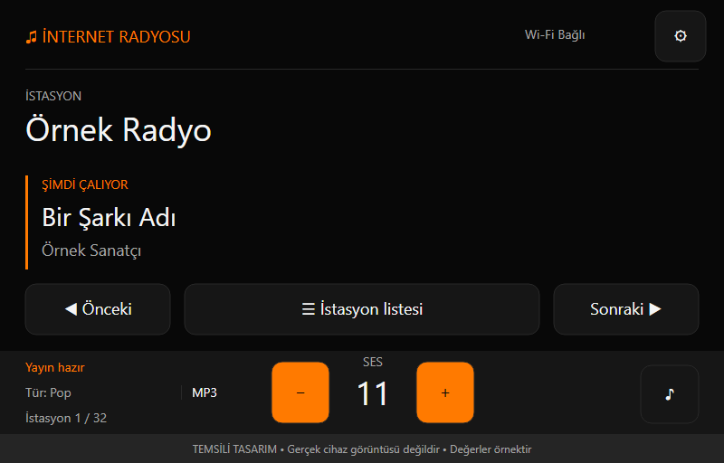

# ESP32 Internet Radio & SD MP3 Player

An ESP32-S3 touchscreen internet radio and offline SD MP3 player with a black-and-orange interface, English/Turkish device menus, and local web control.

**Project creator & maintainer: fsadak** · **Firmware: 0.10.0** · **PlatformIO / Arduino**

**English** | [Türkçe](README.tr.md)



*Earlier interface design preview, not a photograph or capture from the device. The current firmware also includes SD MP3 controls and language selection.*

## Features

| Area | Available functionality |
| --- | --- |
| Internet radio | Wi-Fi streaming, station list, previous/next station, stream title, genre and codec information when available |
| SD MP3 | Folder browsing, play/pause, previous/next track, −10/+10-second seeking, elapsed/total time |
| Playback modes | Repeat one, repeat playlist and shuffle |
| Sound | Volume −/+, numeric volume display, mute, bass/mid/treble equalizer |
| Languages | English and Turkish device UI; English by default; persistent selection in Settings |
| Wi-Fi setup | On-screen network scan, manual SSID entry, masked password entry and saved network settings |
| Station management | Shared CSV format for the web interface and offline import from SD |
| Local web interface | Radio control, station editing/reordering, CSV import/export and device status |
| Display | Adjustable brightness, automatic dimming, backlight off and touch-to-wake |
| VU meter | Horizontal digital level bar and peak marker; optional in Settings; measurement and drawing stop while the backlight is off |
| Startup | Remembers the last radio/MP3 source and the last selected MP3 file |

The initial station is **SomaFM Groove Salad**. You can replace the station list with your own.

## Hardware

The project has been tested on **Sunton ESP32-8048S070, PCB V1.3**.

| Component | Configuration |
| --- | --- |
| MCU | ESP32-S3 |
| Flash / PSRAM | 16 MB flash / 8 MB OPI PSRAM |
| Display | 7-inch, 800 × 480 RGB touchscreen |
| Audio | MAX98357 I²S amplifier, mono output |
| Speaker used during development | 4 Ω / 3 W |
| Power | 5 V USB supply |
| SD card | Required for local MP3 playback and SD station-list import |

Verified pin assignments:

| Signal | GPIO |
| --- | ---: |
| I²S BCLK | 0 |
| I²S LRC / WS | 18 |
| I²S DOUT | 17 |
| SD CS | 10 |
| SD SCK | 12 |
| SD MOSI | 11 |
| SD MISO | 13 |

The custom board definition keeps the working RGB display configuration. Touch is polled; the GT911 interrupt pin is unused because GPIO18 is assigned to audio. Other board revisions may need different settings.

### Observed power consumption

Measurements reported during development, taken at the USB input:

| Display state | Power | Current |
| --- | ---: | ---: |
| Full brightness | 1.83 W | 0.37 A |
| Backlight off | 0.85 W | 0.17 A |

These are operating measurements, not maximum ratings or sleep-current measurements. Actual consumption depends on playback, volume and network activity.

## Build and install

Use [PlatformIO](https://platformio.org/) with the checked-in configuration. A USB data connection is needed for firmware upload.

| Setting | Version / value |
| --- | --- |
| Platform | `espressif32@6.10.0` |
| Framework | Arduino |
| Environment | `esp32_radio` |
| Board | `sunton-8048s070-radio` — included under `boards/` |
| Flash / partition table | 16 MB / `default_16MB.csv` |
| Memory configuration | `qio_opi`, OPI PSRAM |
| LVGL | `9.6.0` |
| ESP32-audioI2S | Vendored `2.0.7` with local fixes |
| esp32_smartdisplay | Vendored `2.1.2` with local fixes |
| Serial monitor | 115200 baud |

1. Download or clone the project and open the folder containing `platformio.ini`.
2. Allow PlatformIO to install the pinned platform and dependencies.
3. Connect the board and select its actual serial port if automatic detection does not find it.
4. Use **Build**, then **Upload** in PlatformIO.
5. Open the serial monitor if diagnostics are needed.

Equivalent PlatformIO CLI commands:

```sh
pio run -e esp32_radio
pio run -e esp32_radio -t upload
pio device monitor -b 115200
```

Keep the checked-in `lib/` directories: they contain changes required by this firmware. Replacing them with unmodified upstream releases can reintroduce earlier problems. No separate web-filesystem upload is needed; the web page is embedded in the firmware.

## First use

1. With no saved network, the device opens Wi-Fi setup. Choose a **2.4 GHz** network, enter its password and select **Connect and save**.
2. Select a station from the main screen. Use the **− / numeric value / +** controls to adjust volume.
3. To change language, open **Settings → Device → Dil / Language**, select **English** or **Türkçe**, then **Save**.
4. Language changes apply without restarting the device. **Cancel** keeps the previous language. Other settings use the same Save/Cancel workflow.

Network settings can be changed later under **Settings → Device → Set up / change Wi-Fi**. The device stores one network profile. Wi-Fi credentials are entered on the device rather than compiled into the source.

For offline MP3 playback, close Wi-Fi setup if it is open, insert the SD card and select **SD MP3**. An internet connection is not required for local music.

## SD MP3 playback

- Place MP3 files in the SD card root or in subfolders.
- Open **SD MP3**, enter a folder and select a file. The MP3 files in that folder become the playback list.
- Browsing another folder leaves the current track and playback list unchanged until a new file is selected.
- Use **Play/Pause**, **Previous/Next**, **−10/+10**, repeat and shuffle on the main screen.
- Title/artist information uses ID3 metadata when available; otherwise the filename is shown.
- The time field shows elapsed and total time. Seeking is enabled once the decoder has enough timing information; VBR timing remains approximate.
- With repeat disabled, playback advances automatically and stops after the last track.
- Use **Radio / Back to radio** to return to the radio source.

**After a restart, the last MP3 starts from the beginning.** Track position and paused state are intentionally not persisted. Earlier periodic position saves caused visible RGB display shifts; removing those writes resolved the observed periodic and seek-related shifts. Source/file changes are still saved.

The MP3 browser lists at most **128 MP3 files/subfolders per folder**, scans at most **512 directory entries**, and accepts paths up to **240 bytes**. Only `.mp3` files are listed, case-insensitively. M4A, WebM and other local formats are outside this player's current scope.

## Station lists: one CSV format

The web interface and SD import use **UTF-8, semicolon-separated CSV**:

```csv
name;url
Groove Salad;https://ice5.somafm.com/groovesalad-128-mp3
```

| Limit | Value |
| --- | ---: |
| Stations stored on the device | 32 |
| CSV file size | 12 KiB |
| Station name | 96 bytes |
| Stream URL | 512 bytes |

URLs must be valid HTTP/HTTPS stream addresses. A broadcaster's ordinary website or player page is not necessarily a direct stream URL. UTF-8 byte limits are not character counts.

For offline import:

1. Copy CSV files to the **SD card root directory**.
2. In Radio mode, open **Settings → Stations → Import list from SD card**.
3. Select a file and review the confirmation.
4. Select **Replace list** to overwrite the device's entire station list, or **Cancel** to leave it unchanged.

The imported list is stored in internal NVS and remains available after removing the card. Import is a separate confirmation: cancelling the surrounding settings menu does not undo a confirmed list import. The firmware does not format or write to the SD card. Merging/appending lists is not implemented.

Examples are available in [design/sd-lists](design/sd-lists) and [the Turkish station collection](design/turkiye-radyo-listesi). The larger collection is split into device-sized lists; not every endpoint has been verified, and stream addresses may change.

## Local web interface

Connect a phone or computer to the same network. Find the device address under **Settings → Device**, then open:

```text
http://DEVICE_IP/
```

The current web interface provides radio playback controls, volume/mute, station selection, station editing/reordering and CSV import/export. Station edits remain a browser draft until saved to the device.

**Current boundaries:**

- The web interface is currently **Turkish only**; device language selection does not translate it.
- Web changes are blocked while local settings/Wi-Fi setup are open and while the source is SD MP3. Status remains readable.
- There is no web MP3 browser or MP3 upload/control yet.
- The server uses local HTTP without login or TLS. It is intended for a trusted LAN; internet exposure and port forwarding are outside the supported setup.

## Display and sound settings

- **Brightness:** adjustable, with the saved level restored on startup.
- **One idle timeout:** first reduces the configured brightness to 50%; **15 seconds later** the backlight turns off. Selecting **Off** disables both stages.
- **Wake:** the first touch only wakes the display; it does not activate the control underneath.
- **VU meter:** an orange bar and white peak marker below the heading, updated every 100 ms with a 600 ms peak hold. Disable it under Settings → Display. It follows Save/Cancel; measurement and drawing stop when the backlight is fully off and resume on wake if enabled. This is not a calibrated acoustic level measurement.
- **Equalizer:** bass, mid and treble, −12 to +6 dB, with a Flat preset.
- **Startup:** volume limit, startup volume, remember volume, radio autoplay and station selection preferences.

The last radio/MP3 source is remembered. Radio startup follows the configured autoplay/station settings; an unavailable last MP3/card produces a message in MP3 mode rather than silently starting the radio.

## Known limitations and design choices

- A slight audio disturbance can occur while brightness is being adjusted; this is a recorded, accepted limitation.
- Brief RGB image shifts may still occur during flash writes such as source/track or settings saves. Periodic MP3 position writes have been removed.
- MP3 titles stay **static and ellipsized**. Scrolling long titles previously caused audio interruptions; static titles resolved that reported issue.
- Broadcast loudness varies. Automatic normalization/AGC is not included; manual volume and EQ remain available.
- Bluetooth audio is outside this project's scope. ESP32-S3 does not provide Bluetooth Classic/A2DP support.
- Stream availability, codecs and metadata depend on the broadcaster. Some MP3/AAC streams have been tested; universal codec/HLS compatibility is not claimed.
- Turkish/Latin text is supported by the bundled fonts; this is not a complete Unicode font set. Broadcaster metadata, filenames and SSIDs are preserved rather than translated.
- Basic features have been tested on one hardware setup. That does not certify every SD card, network, board revision or stream.

## Roadmap

- Redesign and extend the web interface, including English support and more device controls.
- Add firmware updates over the local web interface (OTA); not implemented yet.
- Add station-list merge/append as an alternative to replacement.
- Continue network, storage, error-path and long-duration testing.
- Later hardware work: **two 3200 mAh 18650 cells in a 1S2P pack**, UPS power integration and external status LEDs. This is a plan, not an installed or tested battery system. An on-screen battery gauge is currently out of scope.

Folder browsing, ±10-second seeking, source/file recall and English/Turkish device menus are already implemented. Resuming a saved MP3 time position is not a pending feature; that requirement was withdrawn.

## Project layout and documentation

```text
boards/          Custom Sunton board definition
include/         Application headers, UI configuration and embedded web page
src/             Radio, MP3, settings, localization and generated font sources
lib/             Vendored audio/display libraries and local change notes
design/          Design notes, station-list examples and font licensing
tests/host/      Host-side test sources and stubs
platformio.ini   Pinned PlatformIO build configuration
```

Detailed engineering notes are currently mainly in Turkish:

- [Language support and confirmed tests](design/LANGUAGES.md)
- [SD MP3 behavior](design/SD-MUSIC.md)
- [CSV station lists](design/STATION-LISTS.md)
- [Wi-Fi setup](design/WIFI-SETUP.md)
- [Settings](design/SETTINGS.md)
- [Web interface](design/WEB-INTERFACE.md)
- [Battery plan — deferred hardware work](design/BATTERY-POWER.md)
- [Roadmap](design/TODO.md)

Generated font sources are included; regeneration is documented under [design/fonts](design/fonts).

## Credits and licensing

Project direction, integration and maintenance: **fsadak**. This firmware builds on work by other authors; their notices and licenses remain applicable.

| Component | Source / licensing note |
| --- | --- |
| ESP32-audioI2S 2.0.7 | [esphome/ESP32-audioI2S](https://github.com/esphome/ESP32-audioI2S), originally by schreibfaul1; [bundled GPLv3 license](lib/ESP32-audioI2S/LICENSE) |
| esp32_smartdisplay 2.1.2 | [rzeldent/esp32-smartdisplay](https://github.com/rzeldent/esp32-smartdisplay), René Zeldenthuis; upstream metadata says MIT while its bundled LICENSE contains GPLv3; review remains open |
| LVGL 9.6.0 | [LVGL](https://github.com/lvgl/lvgl), MIT; retain its copyright/license notices |
| Espressif components | Individual vendored files carry Apache-2.0 notices; preserve those notices and applicable license terms |
| Montserrat font data | [Montserrat Project](https://github.com/JulietaUla/Montserrat); [SIL Open Font License 1.1](design/fonts/Montserrat-OFL.txt) |

Local modifications are described in [audio changes](lib/ESP32-audioI2S/LOCAL-CHANGES.md) and [display changes](lib/esp32_smartdisplay/LOCAL-CHANGES.md).

**Licensing:** Original project contributions are offered under [GNU GPLv3](LICENSE), as described in [AUTHORS.md](AUTHORS.md). Third-party rights remain separate. The Helix-origin decoder licensing chain remains unresolved; clarification was requested in [upstream issue #23](https://github.com/esphome/ESP32-audioI2S/issues/23). See [THIRD_PARTY_NOTICES.md](THIRD_PARTY_NOTICES.md) for the retained notices and open questions. Publication does not resolve those questions or establish an additional license grant.

## Contributing

The project is maintained by **fsadak**. Contributions can be proposed through issues and pull requests once the repository is published; changes enter the official version after maintainer review.

For a useful bug report, include the firmware version, board/PCB revision, reproduction steps, expected/actual behavior and relevant logs. Remove passwords, tokens and personal network information before sharing. Do not include flash/NVS dumps or private backups.

Please distinguish device-tested results from proposals, simulations and design previews.
