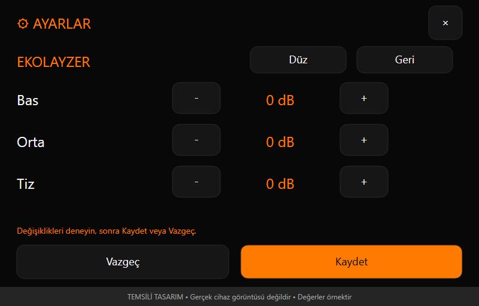

# ESP32-S3 ile dokunmatik internet radyosu

7 inç dokunmatik ekranlı, siyah ve turuncu temalı bir internet radyosu geliştiriyorum. Amacım, günlük kullanımda bilgisayara ihtiyaç duymadan istasyon seçebildiğim, ses karakterini ayarlayabildiğim ve kendi yayın listelerimi yükleyebildiğim bağımsız bir cihaz oluşturmak.

Proje şu anda Wi-Fi üzerinden radyo çalma, Türkçe dokunmatik arayüz, kalıcı ayarlar, SD karttan istasyon listesi yükleme ve üç bantlı ekolayzer özelliklerine sahip. Çalışan güncel sürüm **0.5.0**. Bu bir geliştirme projesi; mevcut işlevlerle yol haritasındaki özellikleri aşağıda ayrı ayrı paylaşıyorum.

## Donanım

| Bileşen | Kullanılan yapı |
|---|---|
| Ekran kartı | Sunton ESP32-8048S070, PCB V1.3 |
| İşlemci | ESP32-S3 |
| Flash | 16 MB |
| PSRAM | 8 MB OPI; bellek kontrolünde yaklaşık 8 MB kullanılabilir alan görüldü |
| Ekran | 7 inç, 800 × 480 piksel, yatay RGB panel |
| Dokunmatik | GT911 kapasitif dokunmatik |
| Ses | MAX98357 amplifikatör, mono çıkış |
| Hoparlör | 4 ohm, 3 W |
| Depolama | Ayarlar ve istasyon listesi için dahili NVS; liste aktarımı için SD kart |

Hoparlörün 3 W değeri, sistemden ölçülmüş çıkış gücü anlamına gelmiyor. Mevcut aşamada mono ses çalışıyor; daha yüksek ses, farklı hoparlör/kabin ve güç tüketimi optimizasyonu ayrı geliştirme konuları.

## Ana ekran: az dokunuşla kullanım

Ana ekranda istasyon adı, yayıncı gönderiyorsa şarkı ve sanatçı bilgisi, Wi-Fi bağlantı durumu, yayın durumu, tür ve yayın formatı gösteriliyor. Alt bölümde seçili istasyonun listedeki sırası da yer alıyor.

Ses için kaydırıcı yerine büyük **eksi ve artı tuşları** kullandım. Ses seviyesi bu iki tuşun ortasında görünüyor. Ayrı bir sessize alma düğmesi var. Önceki/sonraki tuşlarıyla istasyon değiştirilebiliyor; listenin sonundan başına ve başından sonuna geçilebiliyor. İstasyon listesi düğmesiyle doğrudan seçim de yapılabiliyor. Tek istasyonlu listede gereksiz gezinme kontrolleri pasif kalıyor.

Uzun şarkı adları kayarak görüntüleniyor. Yazı tipleri ve menüler Türkçe karakterleri destekliyor. Şarkı ve sanatçı ayrımı, yayıncının gönderdiği başlığın biçimine bağlı; her yayıncı aynı metadata düzenini kullanmıyor.


*Bu ve aşağıdaki görseller, mevcut kodun yerleşimi ve renkleri esas alınarak hazırlanmış temsili ekran çizimleridir. Gerçek cihazdan alınmış ekran görüntüleri değildir. İstasyon, şarkı, tür ve ayar değerleri örnektir.*

## Yayın bilgileri nasıl ele alınıyor?

Tür alanı yayıncının gönderdiği `icy-genre` bilgisini kullanıyor. Yayıncı tür yerine kanal adını gönderiyorsa, mevcut istasyon adıyla eşleşen değer filtreleniyor. Bilgi yoksa tür alanında `—` gösteriliyor; istasyon adına bakılarak kategori tahmin edilmiyor.

Format alanı, URL uzantısından tahmin edilmek yerine çalışan ses çözücüsünden alınıyor. MP3 ve AAC yayınları gerçek cihazda dinlendi. Bu, internetteki bütün yayınların veya kütüphanenin tanıyabildiği bütün biçimlerin cihazda doğrulandığı anlamına gelmiyor.

Şarkı bilgisi göndermeyen yayınlarda sürekli “Parça bilgisi bekleniyor” yazısı bırakılmıyor; şarkı ve sanatçı satırları boş kalıyor. Bilgi sonradan gelirse otomatik gösteriliyor. İstasyon değiştirildiğinde önceki yayından kalan bilgiler temizleniyor. HTTP hata yanıtları şarkı adı olarak gösterilmiyor.

## Ses ve üç bantlı ekolayzer

Ana ses seviyesi **0–21** aralığında. Açılış ses seviyesi ve izin verilen azami seviye ayrı ayarlanabiliyor. İstenirse cihaz son kullanılan ses seviyesini hatırlıyor; istenirse her açılışta belirlenen sabit seviyeden başlıyor.

**Ayarlar → Ses → Ekolayzer** bölümünde bas, orta ve tiz ayrı ayrı değiştirilebiliyor:

- Her bant için **−12 ile +6 dB** aralığı ve 1 dB adımlar.
- Her satırda eksi tuşu, sayısal değer ve artı tuşu.
- Değişiklikleri dinlerken anında duyabilme.
- **Düz** ile üç bandı da 0 dB’ye döndürme.
- **Kaydet** ile kalıcı saklama; **Vazgeç** ile kayıtlı değerlere dönme.
- **Geri** ile taslak değerleri koruyarak Ses bölümüne dönme.

Ekolayzer mevcut ses kütüphanesinin dijital filtreleriyle çalışıyor; ek donanım gerektirmiyor. Bu, üç bantlı bir ton kontrolü; çok bantlı grafik ekolayzer veya spektrum analizörü bulunmuyor. Küçük hoparlörün bas üretimi fiziksel olarak sınırlı. Yüksek sesle birlikte fazla pozitif kazanç kullanıldığında seste bozulma oluşabilir.



## Ayarlar ve kalıcılık

Ayarlar beş bölümden oluşuyor: **Ekran, Ses, Radyo, İstasyonlar ve Cihaz**.

Ekran bölümünde parlaklık yaklaşık %5–100 arasında ayarlanabiliyor. Otomatik karartma kapatılabiliyor veya **30 saniye, 1, 2, 5 ve 10 dakika** olarak seçilebiliyor. Kararma sonrası ilk dokunuş yalnızca ekranı uyandırıyor; dokunulan yerdeki ses veya istasyon düğmesini yanlışlıkla çalıştırmıyor. Mevcut işlev karartma; ekranı tamamen kapatma henüz eklenmedi.

Radyo bölümünde açılışta otomatik yayın seçilebiliyor. Cihaz son dinlenen istasyondan devam edebiliyor veya belirlenen sabit istasyonla açılabiliyor. Otomatik yayın kapalıysa kullanıcı istasyon seçene kadar bekliyor.

Cihaz bölümünde Wi-Fi bağlantısı, sinyal gücü, yerel IP ve yazılım sürümü görülebiliyor. Arayüzde Wi-Fi şifresi gösterilmiyor. Cihaz üzerinden ağ seçimi ve şifre girme ekranı henüz yok.

Parlaklık ve ses ayarları menü açıkken denenebiliyor. Kaydet ile dahili belleğe yazılıyor; Vazgeç veya ayarları kapatma, önceki ayarları geri getiriyor. Kayıt başarısız olursa menü hata bildiriyor. Ekolayzer eklenirken önceki sürümün ayarlarını okuyabilen bir geçiş de eklendi; eski tercihlerin sırf bu özellik eklendi diye sıfırlanması amaçlanmıyor.

Son ses ve istasyon bilgisi normal kullanımda son değişiklikten yaklaşık iki saniye sonra kaydediliyor. Bu kısa süre içinde güç kesilirse son değişiklik hatırlanmayabilir. Uzun süreli dayanıklılık ve gerçek güç kesintisi testleri ayrıca yapılmalı.

## SD karttan seçilebilir istasyon listeleri

İstasyon listelerini basit bir metin dosyasıyla hazırlayabiliyorum. Biçim **UTF-8 kodlamalı, noktalı virgülle ayrılmış CSV**:

```csv
name;url
Groove Salad;https://ice5.somafm.com/groovesalad-128-mp3
```

SD kartın kök dizinine birden fazla `.csv` dosyası koymak mümkün. **Ayarlar → İstasyonlar → SD karttan liste yükle** yolunda dosya listesi açılıyor. Dosya seçildikten sonra içerik doğrulanıyor, dosya adı ve istasyon sayısı gösteriliyor. Kullanıcı ayrıca onay verirse cihazdaki listenin tamamı değiştiriliyor.

Liste dahili belleğe kaydedildiği için aktarım sonrasında SD kartı çıkarmak mümkün. Cihaz aynı listeyle çalışmaya devam ediyor. Liste yüklemek için internet bağlantısı gerekmiyor; yayınları dinlemek için gerekiyor. Açılışta otomatik dosya yükleme yapılmıyor.

Hatalı veya eksik dosya mevcut listeyi değiştirmiyor. Boş URL, hatalı UTF-8, fazla sütun ve birebir tekrarlanan URL gibi durumlar reddediliyor. Doğrulama dosyanın yapısını kontrol ediyor; bir adresin o anda gerçekten yayın yaptığını garanti etmiyor.

Mevcut sınırlar:

| Alan | Sınır |
|---|---|
| Cihazdaki liste | 12 KiB sınırı içinde en fazla 128 istasyon |
| CSV dosyası | En fazla 12 KB |
| İstasyon adı | En fazla 96 bayt |
| Yayın URL’si | En fazla 512 bayt |
| Dosya seçimi | En fazla 64 CSV dosyası |
| SD kök dizini taraması | En fazla 512 dizin kaydı |

Türkçe harfler UTF-8’de birden fazla bayt tutabildiği için bayt sınırları karakter sayısıyla birebir aynı değil. HTTP ve HTTPS doğrudan yayın adresleri kullanılabiliyor; kullanıcı adı/şifre içeren URL’ler kabul edilmiyor. Alt klasörler taranmıyor. SD karta dosya yazma veya kart biçimlendirme yapılmıyor.

**Önemli kullanım ayrıntısı:** İçe aktarma listeye ekleme yapmıyor; mevcut listenin tamamını değiştiriyor. Bu işlem kendi onayına sahip. Sonradan genel ayarlar ekranında Vazgeç seçmek, onaylanıp yüklenmiş istasyon listesini geri almıyor.

## Türkiye radyo arşivi

Proje için **222 farklı kanallık** bir arşiv hazırlandı: **190 doğrudan MP3/AAC kanalı** ve ayrı tutulan **32 HLS deneme kanalı**. Seçme yayınlar, pop/slow, türkü/arabesk, alternatif/caz, haber/spor, dini ve yerel/üniversite listeleri gibi hazır CSV dosyaları bulunuyor. Hazır dosyalar önceki 32 istasyon sınırına göre bölünmüştür; 0.14.1 sürümünde 12 KiB içinde en fazla 128 kayıt desteklenir. Yeni kapasitenin cihaz doğrulaması beklenmektedir.

Bu sayı aynı anda cihazda 222 istasyon saklandığı anlamına gelmiyor; farklı listelerden isteneni yüklemek mümkün. Adreslerin hazırlık sırasında bilgisayarda kontrol edilmiş olması da tamamının ESP32’de çalıştığını göstermiyor. Yayın adresleri zaman içinde değişebilir.

32 istasyonlu seçme listenin yüklenmesi, son sayfaya erişim ve son istasyondan ilk istasyona dönüş gerçek cihazda doğrulandı. Türkiye listesinden **Radyo 7, Süper FM, TRT FM ve Radyo Spor** dinlendi. Diğer Türkiye kanalları ve HLS listesi için cihaz doğrulaması henüz tamamlanmadı. Daha önce SomaFM yayınlarıyla da ses ve istasyon geçişleri denendi.

## Bağlantı hataları ve toparlanma

Yayın bağlantısı kesildiğinde veya yanıt alınamadığında yazılımın bağlantı durumu takip ediliyor. Geçici hatalarda **3, 10 ve 30 saniyelik gecikmelerle en fazla üç otomatik yeniden deneme** uygulanıyor. Başlangıçta yayın hazır bilgisi gelmemesi için 20 saniyelik kontrol bulunuyor. Kalıcı hatada veya denemeler bittiğinde kullanıcı durum mesajından bilgilendiriliyor; istasyon yeniden seçilebiliyor.

Geliştirme sırasında reset sonrasında bazen `HTTP/1.1 403 Account already in use` yanıtı görülüyordu. Gereksiz boş kimlik doğrulama başlığının kaldırılması ve bağlantı yönetiminin düzeltilmesinden sonra yapılan birkaç reset denemesinde sorun tekrarlanmadı. Bunun her sunucuda ve her ağ koşulunda kesin olarak çözüldüğünü iddia etmiyorum. Hata zorlanarak tüm otomatik toparlanma yollarının cihazda doğrulanması hâlâ ayrı bir test konusu.

## Bilinen durumlar: ne kabul edildi, ne edilmedi?

| Durum | Mevcut değerlendirme |
|---|---|
| Parlaklık ayarı sırasında hafif ses paraziti | Kullanımda seyrek yapılan bir işlem olduğu için mevcut aşamada kabul edildi ve kayda alındı. Bu kabul normal dinlemede sürekli paraziti kapsamıyor. |
| Yayıncının şarkı veya tür bilgisi göndermemesi | Kaynak kısıtı; arayüz boş alan veya `—` ile ele alıyor. Cihaz eksik bilgiyi üretemez. |
| Son ses/istasyon değişikliğinden hemen sonra güç kesilince son değerin kaydedilmemesi | Yaklaşık iki saniyelik gecikmeli kayıt davranışının sınırı. |
| Küçük hoparlörde sınırlı bas ve yüksek kazançta bozulma ihtimali | Donanım ve kazanç sınırı; yüksek ses kalitesi için ayrıca hoparlör/kabin ve seviye çalışması gerekli. |
| Yayın adresinin kapanması veya sunucunun erişimi reddetmesi | Dış kaynağa bağlı; durum doğru bildirilmeli ve yeniden seçim mümkün olmalı. |

**Kabul edilebilir saymadığım davranışlar** ise normal dinleme sırasında sürekli ses kesilmesi, arayüzün donması, ekranın okunamaması, Türkçe yazıların bozulması, hatalı dosyanın çalışan listeyi silmesi ve Kaydet/Vazgeç işlemlerinin beklenen sonucu vermemesi. Bunlar mevcut sürümde hepsinin yaşandığına ilişkin bir hata listesi değil; proje için kalite beklentilerim. Daha önce görülen kayan ekran deseni, Türkçe karakter sorunu ve parlaklık kaydırılırken sesin tamamen kesilmesi kullanıcı testleriyle giderildi; hafif parlaklık paraziti ayrı tutuluyor.

Ekolayzerin ilk kullanımına ilişkin geri bildirim olumlu. Bununla birlikte her bant sınırı, sıfırlama, Vazgeç, yeniden başlatma sonrası kalıcılık ve eski ayar geçişinin ayrı ayrı tamamlandığını gösteren ayrıntılı test kaydı henüz yok. Gerçek kayıt hatası, kayıt sırasında güç kesilmesi, SD sınır koşulları ve uzun süreli kesintisiz çalışma da tamamlanmış testler olarak sunulmuyor.

## Bundan sonra neler var?

- **Web arayüzü:** Yerel ağdan istasyon oluşturma, düzenleme, silme ve toplu liste yönetimi. SD ile aynı CSV biçimini kullanma hedefi var. Henüz çalışan bir web sunucusu veya erişim QR kodu yok.
- **Listeye ekleme/birleştirme:** Mevcut listenin tamamını değiştirmeden yeni istasyon ekleme.
- **SD karttan MP3:** Dosya seçimi, oynat/duraklat, önceki/sonraki parça ve radyo/SD kaynak seçimi. Mevcut SD desteği müzik çalma özelliği anlamına gelmiyor.
- **Bataryalı kullanım:** Önce karartma, daha sonra ayrı bir süreyle ekranı kapatma; ses devam ederken ekranın kapalı kalması ve ilk dokunuşla uyanma. Ekran beslemesini fiziksel kesme yöntemi ayrıca incelenecek.
- **Wi-Fi yapılandırması:** Cihaz üzerinden ağ seçimi ve şifre girişi.
- **Ses ve tüketim çalışmaları:** Daha güçlü ses, hoparlör/kabin seçenekleri ve ölçüme dayalı güç optimizasyonu.

## Yazılım altyapısı

Proje PlatformIO ve Arduino altyapısıyla geliştiriliyor. Güncel yapı `espressif32@6.10.0`, karta özel `sunton-8048s070-radio` tanımı, 16 MB bölümleme ve OPI PSRAM ayarlarını kullanıyor. Arayüz **LVGL 9.6.0** ve yerel **esp32_smartdisplay 2.1.2** kaynağına dayanıyor. Ses tarafında yerel düzeltmeler içeren **ESP32-audioI2S 2.0.7** bulunuyor. İlk ekran denemelerindeki LovyanGFX tanımı güncel arayüzün temeli değil.

Bu proje benim için hazır bir radyoyu taklit etmekten çok, dokunmatik kullanım, ses işleme, yayın bağlantıları ve veri saklamayı aynı cihazda bir araya getiren bir geliştirme çalışması. Özellikle aynı Sunton kartını kullananların deneyimleri, farklı yayınların uyumluluğu ve hoparlör/kabin önerileriyle ilgili geri bildirimleri merak ediyorum.

---
